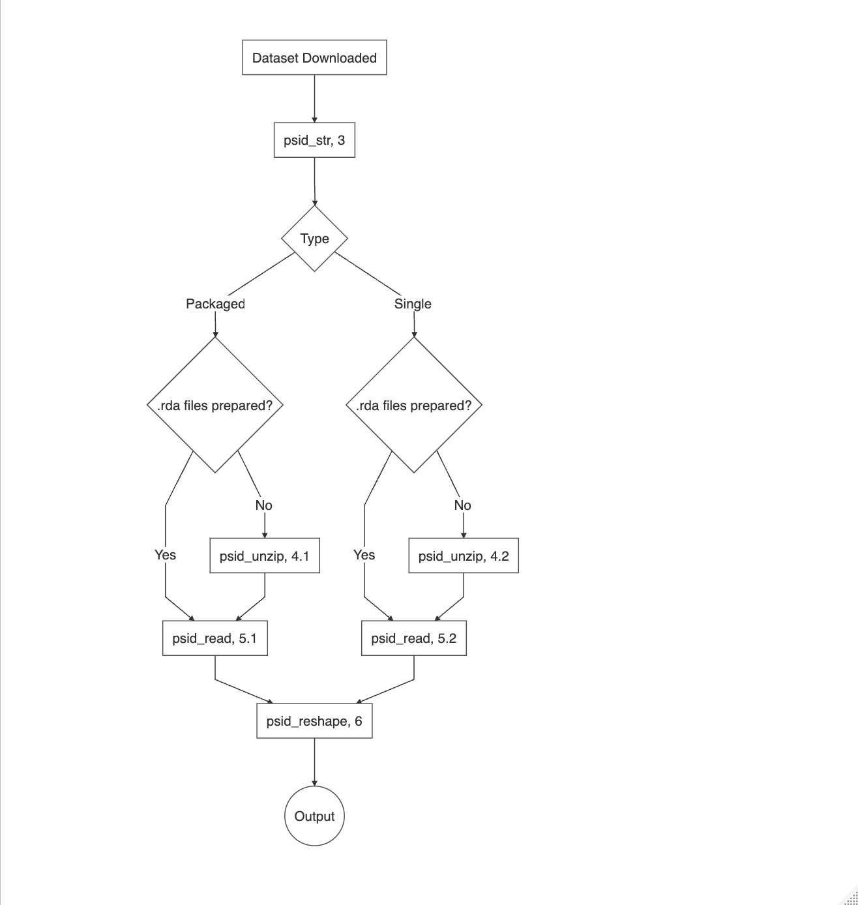

# Summary

Panel Study of Income Dynamics (PSID) is the longest running longitudinal household survey in the world, which provides invaluable data covering numerous topics including marriage, income, wealth, health and etc [@mcgonagle2006]. Since its inception in 1968, the PSID has tracked individuals and families across generations, making it uniquely suited to studying intergenerational mobility, family dynamics, and long-term socioeconomic outcomes.

Despite its value, the structure of PSID data makes the process of converting raw PSID data files into datasets ready for analysis quite complex and challenging, especially for new users. Raw files are distributed in fixed-width ASCII format, with variable names and metadata that change across survey waves. As a result, data preparation often requires extensive manual parsing, reformatting, and cross-wave harmonization, which are error-prone and difficult to reproduce.

The `psidread` R package addresses these barriers by providing a suite of reproducible tools for loading, processing, and harmonizing PSID data. It automates many of the most common steps in preparing PSID files for analysis, enabling researchers to import and tidy data from raw files with minimal overhead and full transparency. By integrating with modern R workflows and the `tidyverse` ecosystem, `psidread` streamlines PSID data preparation for use in quantitative social research.

# Statement of need

The structure and distribution format of the Panel Study of Income Dynamics (PSID) present multiple challenges for efficient and reproducible research workflows. PSID data are provided in two main forms: a cross-year individual file that combines all person-level variables from 1968–2021, and a series of yearly family-level files that contain one record per household per wave [@psid2025]. These files are distributed in fixed-width ASCII format, with metadata supplied separately, requiring researchers to parse, merge, and reshape raw data before analysis. To perform most longitudinal or intergenerational analyses, users have to first merge datasets from different waves, which is a process that is intensive, error-prone, and not easily duplicated or audited.

Data access through the PSID website introduces an additional layer of complexity. While researchers may download either packaged files (large bundles of data for multiple waves) or select specific variables through a customized shopping cart, each method has tradeoffs, as shown in the table below. Bulk downloads offer reusability but require manual unzipping and conversion from ASCII to a usable format in R, often relying on external software like SAS or Stata. Customized downloads, while smaller and already merged, require redundant effort whenever variable lists change, and are not well suited for multi-project workflows.

+---------------+---------------------------------------------------------------------------------------------------------------------+--------------------------------------------------------------------------------------------------------------+
|               | Packaged Files                                                                                                      | Customized File                                                                                              |
+===============+=====================================================================================================================+==============================================================================================================+
| Pros          | 1.  Reusable                                                                                                        | 1.  Take less space                                                                                          |
|               | 2.  Avoid redundant downloading                                                                                     | 2.  Options available for downloading data in the format that can be processed directly using R              |
|               | 3.  Easy to manage if you have multiple projects using PSID                                                         | 3.  Waves already merged by PSID                                                                             |
+---------------+---------------------------------------------------------------------------------------------------------------------+--------------------------------------------------------------------------------------------------------------+
| Cons          | 1.  Hard to merge manually                                                                                          | 1.  The download procedure needs to be repeated if additional variables are added in the analysis            |
|               | 2.  Present in ASCII format and require additional software like SAS or Stata to process before being imported to R | 2.  The same variables are downloaded repeatedly if the user have multiple research projects using PSID data |
|               | 3.  Even with paid software, packaged files still need to be unzipped and converted one by one before analysis      |                                                                                                              |
+---------------+---------------------------------------------------------------------------------------------------------------------+--------------------------------------------------------------------------------------------------------------+

: Other challenges include PSID’s variable naming conventions (e.g., `ER30001`, `V300`), which are not intuitive. In addition, variables are not available consistently in every wave over time. Identifying which variables are available in which waves requires consulting a web-based index, making it difficult to programmatically resolve missingness across years or assemble complete longitudinal records.

These barriers make PSID data preparation both time-consuming and highly individualized across projects. This package addresses these concerns by standardizing the download, import, harmonization, and reshaping of PSID data within the R environment, saving researchers significant effort and promoting reproducibility across studies.

# Target audience

This package is designed for researchers and data analysts who work with PSID data in R and seek a fully reproducible workflow for data preparation and analysis. This includes PSID users who prefer to manage data cleaning, harmonization, and modeling within R as a single language environment, without relying on external tools such as SAS, Stata, or Excel for preprocessing steps. By providing PSID data access and transformation tools directly in R, `psidread` supports consistent, sharable, and scriptable workflows across projects and collaborators.

# Functionality

This package is composed of four functions that can help:

-   `psid_str()`: Create a table of data structure across multiple waves using the text that can be copied and pasted from the website

-   `psid_unzip()`: Unzip and convert the zipped files without additional help of other software

-   `psid_read()`: Read and merge the data files from multiple waves

-   `psid_reshape()`: Rename and reshape the dataset to fit the need for advanced analysis

The `psidread` package supports both of the primary ways PSID data are distributed: bulk packaged files and customized variable subsets downloaded through the PSID data system. The complete workflow, including examples for both download strategies, is detailed in the package [vignettes](https://cran.r-project.org/web/packages/psidread/vignettes/my-vignette.html#1_Introduction). A visual overview of the core workflow is shown in the figure below (number refers to the section in the vignettes).

# Acknowledgements

The author would like to thank the early users of `psidread` for their thoughtful feedback and feature suggestions during the development of the package. Their contributions, including issue reports and usability comments, have significantly improved the functionality and documentation of the software.

Thanks are also due to the PSID project team for maintaining this rich dataset and providing public access help.

# References
